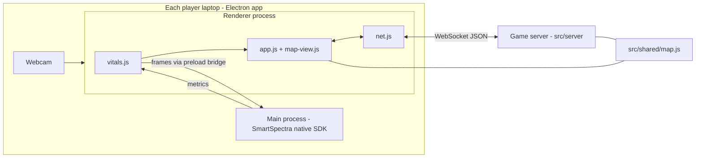

# Architecture

Context for agents and contributors working on Vital Verdict. It records how the system is built and why, so future changes stay consistent with decisions already made. For setup and gameplay instructions, see `README.md`.

## What the product is

A hackathon demo: an Among Us-inspired social deduction game where each player's webcam measures their pulse with the Presage SmartSpectra SDK. Heart rates are shown during meetings, so a pulse spike when accused is a "tell". It runs as a desktop app on each player's laptop. There is no web deployment of the client.

Constraints that shaped every decision:

- **Hackathon scope.** Simple, working, demoable beats general or scalable. Avoid frameworks and build steps unless they pay for themselves.
- **Local first.** Players run the app on their own laptops. The game server runs either on one player's laptop (LAN) or on a single Cloud Run instance (when campus Wi-Fi blocks laptop-to-laptop traffic).
- **One face per camera.** SmartSpectra rejects frames with multiple faces (`kMultipleFacesFound`). Every player needs their own laptop and camera; there is no "many players, one webcam" mode.
- **Original assets only.** Gameplay is Among Us-inspired, but the names, map, art and sounds are original. Do not add Among Us assets or names.

## System overview



- **The Electron app** (`src/main`, `src/renderer`) runs on every laptop. It measures the local player's pulse and renders the game.
- **The game server** (`src/server`) owns all game state and is the single source of truth for phases, roles, votes, tasks and kills.
- **The shared map module** (`src/shared/map.js`) is plain CommonJS, imported by both the server (Node) and the renderer (bundled by esbuild). Map geometry and collision rules exist in exactly one place.

## Repository layout

```
src/main/main.js          Electron main: window, camera permission, .env loading, SmartSpectra IPC binding, in-app "Host game" server
src/main/preload.js       Loads the SDK's preload bridge, exposes window.vv (getConfig, hostGame, log)
src/renderer/index.html   Static shell: vitals sidebar + #main view container
src/renderer/app.js       UI state + screens (setup, lobby, roles, meeting, reveal, gameover), task logic, event handling
src/renderer/map-view.js  Canvas map for the tasks phase: WASD movement, collision, camera, vision fog, E/Q/R actions
src/renderer/vitals.js    SmartSpectra renderer SDK wrapper + simulated source + baseline calibration
src/renderer/net.js       WebSocket client with reconnect, connect timeout, and join diagnostics
src/renderer/sound.js     WebAudio sound effects (no audio files)
src/renderer/styles.css   All styling
src/server/game-server.js Game class (state machine, bots) + createGameServer (HTTP + WebSocket transport)
src/server/cli.js         Standalone server entry (npm run host, Docker/Cloud Run)
src/shared/map.js         Rooms, corridors, collision, task stations, spawn, bot waypoint graph
src/socket-url.js         Turns what the user typed (IP, host:port, https URL) into a ws:// or wss:// URL
test/game.test.js         node:test suite for game logic and the WebSocket server
Dockerfile                Server-only image for Cloud Run
```

`dist/renderer.js` is a build artifact (esbuild output). It is gitignored and rebuilt by `npm start` and `npm run sim`.

## Key decisions

### Desktop Electron app, not a web app

SmartSpectra ships Android, iOS, C++ and Node.js/Electron SDKs; there is no browser SDK. The Node SDK (`@smartspectra/node-sdk`) loads a native library through FFI (koffi), so it must run in a Node context. Electron gives a native SDK host plus a browser UI in one app, and the official docs have an Electron integration path.

### How the SDK is wired (read before touching vitals)

The SDK is split across Electron's processes. This is the vendor-recommended layout:

- **Main process:** `bindSmartSpectraIpc(win)` from `@smartspectra/node-sdk/main` owns the native SDK session.
- **Preload:** `require('@smartspectra/node-sdk/preload')` exposes `window.__smartspectraBridge` (a MessagePort bridge). Our `preload.js` also exposes `window.vv`. Because the preload `require`s an npm module, the window uses `sandbox: false` with `contextIsolation: true`.
- **Renderer:** `SmartSpectraSDK` from `@smartspectra/node-sdk/renderer` captures camera frames with `getUserMedia` and `MediaStreamTrackProcessor`, and ships RGBA frames to main over the bridge. Metrics come back as protobuf buffers, decoded with `decodeMetrics` from `@smartspectra/node-sdk/messages`.

Renderer SDK modules are CommonJS, so the renderer is bundled with **esbuild** into a single IIFE (`dist/renderer.js`). There is no framework (no React/Vue): screens are template-string functions rendered with `innerHTML`.

We request only `MetricType.PULSE_RATE`. HRV needs a 60s window and breathing needs 30s with a stable camera; neither fits the game loop, so they were deliberately left out.

The CSP in `index.html` must allow `worker-src blob:` (the SDK runs a blob worker) and `connect-src ws: wss:` (game traffic).

### Vitals model: baseline and spikes

- Pulse is a ~12-second rolling average from the SDK, with confidence on a 0-100 scale.
- A reading counts toward calibration when `confidence >= 40` or `stable` is true (`MIN_CONFIDENCE` in `vitals.js`). The value 40 was a guess; tune it if calibration never locks or locks on noise.
- **Baseline:** the median of confident readings over the first 20 seconds (`CALIBRATION_MS`) becomes the player's resting pulse ("Vitals locked"). Players can recalibrate.
- **Spike:** the server flags a spike when `bpm - baseline >= spikeBpm` (default 10) and the player is calibrated. Spikes are judged against each player's own baseline, never an absolute BPM, because resting rates vary widely.
- **Known limitation:** camera heart rate fails under motion, talking and laughing, and real social stress often raises pulse only 5-10 BPM. The design assumes meetings are when players sit still. Lowering `spikeBpm`, or measuring relative to the moment of accusation, are the known levers if spikes are too rare.

### Simulated vitals are a first-class mode

With no `PRESAGE_API_KEY`, or with `VV_SIM=1`, `vitals.js` uses a simulated source: a random-walk resting pulse, and holding `H` simulates stress. This enables development without a key, running a second window on one laptop (only one window can use the camera), and a demo fallback. Keep simulated mode working whenever vitals code changes. `S` was originally the stress key and was moved to `H` when WASD arrived; don't bind `W`, `A`, `S`, `D`, `E`, `Q` or `R` to anything else.

### Server-authoritative game state, client-reported vitals and movement

- The server (`Game` class) owns phases, roles, tasks, votes, kills, bodies and timers. Clients send intents (`vote`, `kill`, `report`, ...) and the server validates them: phase, alive, role, range, cooldown.
- **Vitals are trusted from the client.** Each laptop computes its own pulse and sends `hr_update` about once a second. There is no anti-cheat; it's a party game.
- **Movement is client-authoritative with server validation.** The client moves the local player immediately, with collision from `shared/map.js`, and sends `move` messages at about 15 Hz. The server rejects moves that jump more than 120 units or end inside a wall (`MAX_MOVE_PER_MESSAGE`). Rejected moves aren't corrected on the client; a mismatch only lasts until the next respawn. This is deliberate, to avoid building reconciliation for a demo.
- **Range checks** (task stations, kill, report, emergency button) run on the server against server-side positions, with `RANGE_SLACK = 15` to absorb latency.
- **Roles are private.** `viewFor(playerId)` builds a per-player state view. Other players' roles are hidden until they're ejected or the game ends. Private events (`kill` to the victim, `fake_vitals` to the impostor) go only to their target.

### Network protocol

WebSocket with JSON messages. Every message has a `type`.

Client to server: `join {name, clientId}`, `hr_update {vitals}`, `move {x, y}`, `start_game`, `add_bot`, `remove_bot`, `complete_task {taskId}`, `kill {targetId}`, `call_meeting`, `report {bodyId}`, `accuse {targetId}`, `fake_vitals`, `vote {targetId | 'skip'}`, `skip_phase`, `play_again`, `abandon_game`.

Server to client: `welcome {playerId}`, `state {state}` (full per-player view), `positions {positions: [[id, x, y], ...]}`, `event {event}` (toasts and sounds), `error {message}`, `reset`.

Cadence (`createGameServer`):
- `game.tick()` runs every 66 ms (`TICK_MS`); it advances timers and bots.
- `positions` is broadcast every tick, during the tasks phase only.
- Full `state` is broadcast every 15 ticks (about 1 Hz), plus immediately after any event or accepted intent.

Other details:
- **Identity:** `clientId` is a random ID in `sessionStorage`, so each window is a distinct player, and a reload reattaches to the same player. `localStorage` is shared between Electron instances, so don't move identity there.
- **Host:** the first human to join becomes host (`hostId`) and controls start, bots, skipping phases and play-again. If the host leaves, the next connected human inherits it.
- **Joining:** only allowed in the lobby phase; reconnects by an existing `clientId` are allowed any time.
- **`abandon_game`** is an unauthenticated debug reset that clears all players. Anyone who can reach the server can send it. Fine for an event; remove or gate it before anything public.

### Hosting modes

1. **LAN, hosted in-app:** the "Host game" button calls `vv:host` IPC, and the main process starts `createGameServer` on `VV_PORT` (default 7777). Others join `ws://<host-ip>:7777`. On macOS the firewall may block incoming connections to the unsigned dev Electron binary; running `npm run host` (Node, usually already allowed) in a terminal is the workaround.
2. **LAN, standalone:** `npm run host` runs `src/server/cli.js`. The host's own app joins `localhost`.
3. **Cloud Run:** campus Wi-Fi blocked laptop-to-laptop traffic, so the server also runs as a container (`Dockerfile`: server and shared code only, `ws` the only dependency, listens on `PORT=8080`). Clients type the `https://...run.app` URL; `socket-url.js` converts it to `wss://`. The HTTP server answers `GET /` and `/health` with `ok` for health checks, and WebSockets share the same port.

Game state lives in memory in a single process. **Cloud Run must run exactly one instance** (min = max = 1): more than one instance would split players across separate games. Restarting the server ends any game in progress.

`src/server` and `src/shared` must stay free of Electron and renderer dependencies, because the Docker image copies only those two folders.

### Map and movement

- **`shared/map.js`** defines a 2400x1500 world as **rooms and corridors (axis-aligned rectangles)**. The walkable area is their union; there are no wall polygons. `isWalkable(x, y)` tests the center plus 8 points on the player's radius (18), which avoids seam gaps where rectangles meet. Corridors overlap the rooms they join by 10 units for the same reason.
- When editing the map, keep corridors overlapping their rooms, keep task stations, spawn points and waypoint edges inside the walkable area, and run `npm test`.
- **Task stations** are defined in `TASKS`, with a room, a position, and `kind: 'hold' | 'calm'`. Hold tasks take 2.5 s. Calm tasks ("Calm the reactor") need the player's pulse within 6 BPM of baseline for 6 s of accumulated time. Tasks are assigned randomly per player (`tasksPerPlayer`, default 3).
- **Spawn:** players spawn in a circle around the emergency button in the Mess Hall at game start and after every meeting.
- **Vision:** crew see 380 units and the impostor 520. Fog is purely client-side rendering, and the server still sends all positions. Ghosts see everything and move through walls.
- **Rendering:** `map-view.js` draws everything on a single `<canvas>` with `requestAnimationFrame`. The camera follows the player, with about 900 world units visible vertically. Other players are interpolated toward their latest server positions.
- **The canvas is mounted once per tasks phase.** `app.js` re-renders other screens with `innerHTML`, but during the tasks phase it only updates the `#hud` overlay. Rewriting `#main` would destroy the canvas and the movement state.

### Bots

Bots are server-side players (`isBot: true`), so solo testing and one-laptop demos work.
- They have simulated vitals that spike when accused; impostor bots spike harder.
- They walk the waypoint graph in `map.js` (nodes at room centers and corridor junctions, all edges axis-aligned and verified walkable), routing by Dijkstra in `route()`.
- Crew bots walk to their tasks, work on each for `botTaskMs`, and report bodies within range.
- The impostor bot hunts the nearest crewmate and kills when in range and off cooldown.
- They vote probabilistically, favoring whoever is in the spotlight.

Bot movement is scaled by the time elapsed since the last tick, so it behaves the same at any tick rate. Tests rely on that.

### Phases and timing

`lobby` -> `roles` (5 s) -> `tasks` (150 s) -> `discussion` (60 s) -> `voting` (30 s) -> `reveal` (7 s) -> back to `tasks`, or `gameover`.

- A meeting starts from a body report, the emergency button, or the shift timer running out.
- The host can skip any timed phase.
- **Win conditions:** crew win when the impostor is ejected or all crew tasks are done. The impostor wins when impostors alive >= crew alive.
- There is exactly one impostor.
- Timings live in `DEFAULT_CONFIG` in `game-server.js`; tests override them.

### Testing approach

- `npm test` runs the `node:test` suite with no extra dependencies. It covers role assignment and hiding, range checks, wall collision, bodies and reporting, spikes and fake vitals, win conditions, bots playing a full game without clipping walls, and a real WebSocket server relaying vitals and positions.
- `Game` takes an injectable `clock` (`new Game(config, clock)`), and all timing goes through `this.clock()`. Never call `Date.now()` directly inside `Game`; mixing clocks made the bot test flaky before.
- There are no automated UI tests. UI changes are verified by running the app (`npm run sim`, add bots).

## Gotchas

- **`ELECTRON_RUN_AS_NODE=1` is set in Cursor's terminals.** With it, Electron runs as plain Node and `require('electron')` has no API. That's why the `start` and `sim` scripts launch through `env -u ELECTRON_RUN_AS_NODE`. Keep that when changing scripts.
- **Electron's binary download** goes to `~/Library/Caches/electron` on first `npm install`. Sandboxed installs can fail to write there.
- **`VV_PROFILE=<name>`** gives an Electron instance its own `userData` directory, for running two windows on one machine.
- **The SDK needs internet** to validate the API key, even when game traffic stays on the LAN.
- **macOS Local Network permission** (macOS 15+) can silently block the dev Electron binary from connecting to LAN IPs, while `localhost` still works.

## Conventions

- Plain JavaScript, no TypeScript. CommonJS in `src/main`, `src/server` and `src/shared`; ES modules in `src/renderer` (bundled by esbuild).
- No UI framework. Render functions return template strings, and user-provided text goes through `esc()`.
- Comments only for constraints the code can't show. Match the existing code's style.
- Tunable gameplay numbers live in `DEFAULT_CONFIG` (server) or as top-of-file constants (`vitals.js`, `app.js`, `map.js`). Don't scatter magic numbers.
- The `.env` file holds `PRESAGE_API_KEY` and is gitignored. Never commit keys.
